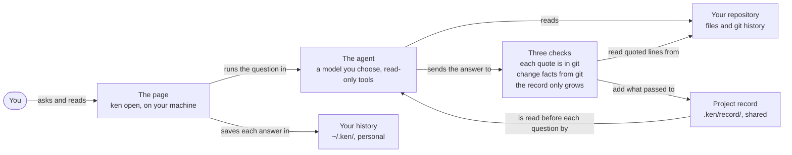

# ken

ken explains a software project to the developer who owns it. It tells you what changed, why it changed, and how a part of the code works now. It is built for projects where AI agents write most of the code.


ken answering a question about its own code, on glm-5.3. The panel shows the answer's first statement, its label, and two of its four quotes, read from git at commit `b5a9226`.

## Status

ken is early work. It is not released, it has no license yet, and there is nothing to install. You run it from a checkout. [site/](site/index.html) holds a public page about it, not yet published.

Slices 0 to 3 of [the plan](docs/plan.md) run: a chat in the terminal about one repository, a project record, and a page in the browser. The model reads the files and the git history with tools that cannot change the project. It must send its answer through a tool that checks every quote against git, and it gets three tries. An accepted answer lists the commits in scope, read from git, and the changed lines that no quote covers. A question about a branch counts only what the branch did since it split from main.

The project record keeps what earlier answers found: pieces of work, the decisions in them, topics, and a note on each topic. It lives in `.ken/record/` in the project's repository, as one JSON Lines file per kind (`work.jsonl`, `decisions.jsonl`, `topics.jsonl`, `notes.jsonl`). ken only adds lines to it, and only through checks: every quote must pass, and commits and authors come from git. ken labels every decision itself. A decision is "recorded" when its reason was written down when the work was done: a coding agent logged it with `ken decide` as it made it, or its reason quotes a commit message. It is "from the session" when its reason quotes a session the coding agent saved, read afterwards. Otherwise it is "inferred", because the model worked it out from the diff. When a reason quotes a saved session, the record keeps the session's id, the message's number, who wrote it and when, and the quoted lines after ken hid what looks like a secret in them, and no other text of the session. Commit `.ken/` only if you are happy to share those lines. Each question starts by showing the model the record, so asking again reads the stored answer instead of exploring again. ken never commits. You commit `.ken/` yourself, so a collaborator and their agents can read it.

Slice 3 adds the page. `ken open` starts a server on your machine and opens the page in your browser. You ask in a box at the bottom. While the agent works, the page shows each step it takes in plain words, and a Stop button. The answer comes as statements, decisions and risks, each with its label and the code it quotes; open a quote to read all its lines. Beside the answer, ken shows what it checked: the quotes, the changed code that no quote covers (as diffs), and the commits, all read from git. The page keeps every question you ask, with its answer, in `~/.ken/projects/<first commit>/history.jsonl`. That file is yours and stays out of the project. Come back the next day and the page shows the answers again without asking the model.


What ken checked, beside its answer to "What did the last commit do?" about its own repository.

A high-level question, such as how the parts fit together or what happens when a request comes in, gets an answer that leads with one or two basic diagrams: boxes and arrows, the steps of a sequence, or the data and how it relates. The model sends the boxes and arrows as data, never diagram syntax. Every arrow must quote the lines that show it, and those quotes pass the same check as any other. ken writes the Mermaid text itself, and the page draws it. Under each drawing, a numbered row for each box and arrow shows the lines it quotes. ken checked that those lines exist. It did not check that an arrow is true, just as it does not check a sentence.


ken's answer to a question about how its own page works, on glm-5.3. It opens with a sequence diagram.

Slice 5 adds recorded decisions and saved sessions. A coding agent logs a decision as it makes it with `ken decide`, and ken labels it "recorded". "Decisions" in the page's header lists every decision in the record, newest first, with its label, who logged it, and the piece of work it belongs to. ken also reads the sessions Claude Code saved while it worked on the project: what the person who ran the session asked, and what the agent said. When you ask why something was done and neither the code nor the commit messages say, the agent looks for the session that ran when those commits were made and quotes it. ken checks that the quoted lines are in that session, and labels what rests on them "from the session". It does not check that they give the true reason. A session quote shows when the session ran and who wrote the lines, with no file and no commit.

Before any session text reaches the model, the page, your history or the record, ken hides what looks like a credential: keys with a known start such as `sk-` or `ghp_`, bearer tokens, random-looking values given to a name such as `KEY`, `TOKEN`, `SECRET` or `PASSWORD`, and the values of such variables in ken's own environment. This is best effort: a secret written in plain words, or a short one, gets through. The session text the agent reads goes to the model provider you chose, as the code does. Set `KEN_SESSIONS=off` to stop ken reading sessions.

How ken works today:



The public page in `site/` draws the same parts and arrows.

`ken chat` and `ken ask` take the place of the page in the terminal. They print a diagram as its numbered rows, and `--json` carries its Mermaid text.

ken runs on a model you choose. It has been run on glm-5.3 through Ollama Cloud. One open-weight model that was tried could not follow the quoting rules.

Slice 4 adds the understanding map: what you understand of the project, topic by topic. It is personal, so it lives beside your history in `~/.ken/projects/<first commit>/map.jsonl` and never in the project. Each line is a small JSON object you can read and type: the topic, a depth (`heard-of`, `can-follow` or `could-change`), the evidence (`asked`, `read`, `said` or `wrote`), the day, and the hash of the topic's quoted code that day. ken only adds lines, and the newest line for a topic wins. A line you add or change by hand counts as long as it parses; a line that does not parse is skipped and named. A question marks the topics it names as met, which is interest, not understanding. Under each answer, "I know this" marks its topics as understood at the code as it is now, "Too much" makes the next answer on them shorter, and "Go deeper" asks for more and tells the map you need it. The next answer folds each topic you know whose code is unchanged into one line, "You know quote check. Unchanged since 16 Nov. Show it anyway." When a commit changes a line the topic quotes, ken marks it as changed since you understood it and names the lines, whoever made the change. Two lenses use the map: catch up, and what you need to know to work in one part today. A reformat or a rename of a quoted file also marks a topic as changed.

Slice 6 adds following up: ken brings back what waits on you, worked out by plain code from the record, the map and git, with no model. Open means two things. One is a decision the agent marked as needing your call, which you have not answered. The other is a topic you said you know whose quoted code changed since. For each such topic, ken lists the commits that touched its files since you understood it, and who made each by the record's rule: your agent, a collaborator, or unknown. A topic you never met is never listed. "Open (3)" in the page's header leads to the list. "I have decided", with a note if you like, adds to the record a copy of the decision that no longer needs you and keeps your answer; the old entry stays readable. A topic leaves the list when you press "I know this" on it again. Asking about it does not take it off, since a question is interest, not understanding. Two more lenses sit under the question box: what one person or agent changed, and what happened in a span of time, such as the last 14 days or since your last question. The person lens lists their commits and the topics you know that those commits touched, then asks the agent to explain them. The time lens lists the commits and the pieces of work the record has in that span, then asks the agent.

Live mode, which the plan did not have, lets ken explain the work while a coding agent does it. Run it beside your agent, on the page's "Live" view or with `ken live` in a terminal pane. Without a model, ken shows what it sees now: the branch, the files with uncommitted changes and how many lines changed, the last commits, and the last thing you asked your agent, read from its saved session with secrets hidden and no tool output. Then it writes a short note each time a commit lands, and each time uncommitted work has been quiet for 20 seconds and changed by 3 lines or more: what changed since the last note and why, with each claim quoting its lines, a risk when there is a real one, and the reason quoted from the session when the session gives one. A note goes through the same checks as an answer, and a note whose quotes fail is shown as failed. Notes come one at a time, at most one a minute and 12 an hour, and take turns with your questions. Every note is a model call, so live mode is off until you turn it on, and the page shows the pace and what this run spent.

ken never writes to your project, and that holds in live mode. To quote lines nobody has committed, ken copies the uncommitted work into a commit in its own git object folder, `~/.ken/projects/<first commit>/snapshots/`, with HEAD as parent. The project's `.git` and working tree do not change: no object, ref, index or lock. A snapshot takes in what `.gitignore` allows, leaves out `.ken/`, binary files and files over 1 MB, takes at most 8 MB, and says how many files it left out. ken empties the folder when it starts and finds it over 200 MB. A note on uncommitted work cites a commit only your machine has, so it is a draft: it stays in your history, shown as uncommitted work at that time, and adds nothing to `.ken/record/`. A note on commits that landed records what any answer records.

These parts of the plan are not built yet:

- A reader for the saved sessions of a coding tool other than Claude Code.

The plan's checkpoint after slice 3 compares ken with a plain chat with a coding agent, on real pieces of agent work. In round 1, on three pull requests on 15 November 2026, ken won on trusting an answer because of its quotes and on finding it again the next day. It lost on finding a decision or a risk the other missed, so ken did not pass yet. Since then, risks are their own part of an answer, and the prompt asks the agent to read the code outside the diff. The judge's verdict is in [docs/checkpoint/round-1.md](docs/checkpoint/round-1.md). Rounds 2 and 3 were scored by an AI judge and not yet by the owner: [round 2](docs/checkpoint/round-2.md), [round 3](docs/checkpoint/round-3.md), and [round 3 with Claude Opus on both sides](docs/checkpoint/round-3-same-model.md).

## Run it

ken sends your project's code to the model you name, so it has no default model. Set three variables, in the environment or in `.env`:

```sh
KEN_MODEL=glm-5.3                     # the model to ask
KEN_BASE_URL=https://ollama.com/v1    # its OpenAI-compatible endpoint
KEN_API_KEY_ENV=OLLAMA_API_KEY        # the name of the variable that holds the key
```

Then, from this checkout, open the page, chat about the repository in the current folder, or ask one question:

```sh
npm run ken -- chat
npm run ken -- ask "What did this branch do?" --repo ../my-project --json
```

`ask` prints the answer and exits with code 0 when the answer passed the checks. `--json` prints it as one JSON object for scripts, with the entries it added to the record under `recorded`.

`record` shows the project record and needs no model. It lists pieces of work and decisions first. Give an id to see one entry in full, with its quotes; for a topic it also says whether the note still matches the code.

```sh
npm run ken -- record --repo ../my-project
npm run ken -- record 3f9a2b1c4e5d --repo ../my-project --json
```

`decide` logs one decision in the project record, for a coding agent to call while it works. It needs no model. ken labels the decision "recorded", because it was written down when it was made, and keeps the name given with `--by`. The decision goes through the same checks as every other entry. A quote names lines of committed code, at HEAD or with `@<commit>` after it. A decision may also quote nothing, since it often comes before its code. Long text is safer as JSON on standard input, with the same fields; `ken decide --help` lists them.

```sh
ken decide --question "How long does a retry wait?" --chosen "A fixed 100 ms" \
  --reason "No caller needs more yet." --rejected "Exponential backoff: nothing calls for it" \
  --undo easy --quote src/retry.ts:12-14 --by claude-code
ken decide --json < decision.json
```

To let the agents in your other projects call it, run `npm link` once in this checkout: that puts `ken` on your PATH. Then add this paragraph to each project's `AGENTS.md`:

```markdown
**Log decisions with `ken decide`.** Run it the moment you choose between real options, leave a choice for the owner, or do something hard to undo: give the question, what you chose and why, and each option you rejected with its reason. Add `--needs-owner` when the owner should decide, and `--by` with your name. `ken decide --help` shows the rest. A choice with one obvious answer needs no entry.
```

A decision logged before its code is committed has no piece of work yet. Later, the piece of work whose commits start at, or pass through, the commit that was checked out when the decision was logged takes it in. `ken record <id>` shows which.

`sessions` reads the sessions Claude Code saved while it worked on the project, and needs no model. With no id it lists them, newest first: when each started and ended, and how many messages it holds. With an id it prints one session in order: what you asked, what the agent said, and each tool the agent ran on which file or with which command, with the first lines of its output. ken only reads these files. It reads only sessions that started in the project's folder or one inside it, at most the newest 100, and at most 32 MB of each.

```sh
npm run ken -- sessions --repo ../my-project
npm run ken -- sessions 0b7e4c2a-5f1d-4c3e-9a8b-2d6f1e0c9b7a --repo ../my-project --json
```

Claude Code keeps sessions in `~/.claude/projects/`. Set `KEN_CLAUDE_PROJECTS` to read them from another folder.

The chat and the page read the same sessions. The agent can list them, read one around a time or a message, and search them, and it quotes them only to say why something was done. What it reads of a session goes to your model provider. ken hides what looks like a credential first, as best it can. `KEN_SESSIONS=off` turns reading off for `sessions`, the chat and the page. Two labels come from this: "recorded" means the reason was written down when the work was done, by `ken decide` or in a commit message, and "from the session" means it was read afterwards from a saved session, and quoted.

`map` prints your understanding map and the path of its file. It needs no model. To correct the map, add a line to that file; `map` shows the hash each topic has now, and an example line to copy. `catch-up` lists, without a model, the topics whose code changed since you understood them and the work recorded since your last question, then asks the agent to explain them. `area` does the same for one part of the project. With no model set, both still print their list.

```sh
npm run ken -- map --repo ../my-project
npm run ken -- catch-up --repo ../my-project
npm run ken -- area src/server --repo ../my-project
```

`follow-up` prints what is open: the decisions that need your call, and the topics you understood whose code changed since, with the commits that changed them. `who` lists one author's commits, named by email or part of a name, and the topics you know that they touched. `since` lists what landed in a span for everyone, with the pieces of work the record has in it. A span is a day such as `2026-11-01` or a number of days such as `14d`; `who` uses the time since your last question unless you give `--since`. Each prints its list without a model, then asks the agent when a model is set. When the list holds nothing to explain, it asks nothing.

```sh
npm run ken -- follow-up --repo ../my-project
npm run ken -- who bo@example.com --since 14d --repo ../my-project
npm run ken -- since 2026-11-01 --repo ../my-project
```

`open` starts the page for the repository in the current folder, or the one you name, and opens it in your browser. It prints the address too, in case no browser opens. Press Ctrl-C to stop it. With no model set, the page still opens: it shows your earlier answers and says what to set. Ask how the parts of a project fit together and the answer leads with a diagram; choose a numbered row, or a box or an arrow in the drawing, to read the code it rests on. The page draws with Mermaid, which ken serves from its own address. Under each answer, three buttons update your map; "Your map" in the header shows it, and the lenses sit under the question box: catch up, an area, and what changed, by one person or by everyone, in a span you pick. "Decisions" in the header lists the record's decisions, those `ken decide` logged among them. When something waits on you, "Open" in the header lists it, with "I have decided" on each decision and "Explain what changed" and "I know this" on each changed topic.

```sh
npm run ken -- open
npm run ken -- open --repo ../my-project --port 4242
```

`open --live` starts the page with live mode on; the "Live" view's switch turns it on and off too. `live` runs it in the terminal instead: it prints what it sees now, then each note as ken writes it, until Ctrl-C. Both need a model, and each note is one question to it. "Pause" holds the notes, "Write a note now" asks for one at once, and "Open as a question" on a note asks for the full answer on that change.

```sh
npm run ken -- open --live --repo ../my-project
npm run ken -- live --repo ../my-project
```

The server listens only on 127.0.0.1 and answers only its own page. It runs one question or live note at a time. Set `KEN_HOME` to keep ken's own files somewhere other than `~/.ken`.

After a session, commit the record in the project: `git add .ken && git commit -m "chore: update the ken record"`.

### Run ken on Claude through Claude Code

If you have no hosted model to hand, ken can use the Claude Code CLI on your machine. A small endpoint in `scripts/claude-endpoint/` speaks the chat-completions protocol to ken and answers each request by running `claude -p` once. It needs `claude` on the PATH and signed in. It needs no API key.

1. In one terminal, start the endpoint. It listens on 127.0.0.1, port 4141 unless you give `--port`:

   ```sh
   npm run claude-endpoint
   npm run claude-endpoint -- --port 4242
   ```

2. In another terminal, set these four variables, in the environment or in `.env`, and use ken as usual:

   ```sh
   KEN_MODEL=opus                          # passed to claude --model: an alias or a full model id
   KEN_BASE_URL=http://127.0.0.1:4141/v1   # the endpoint
   KEN_API_KEY_ENV=KEN_LOCAL_KEY           # ken needs a key variable of 8 characters or more
   KEN_LOCAL_KEY=not-a-key                 # any text: the endpoint ignores it
   ```

No key leaves your machine on this path. What does leave it is everything ken sends the model: its instructions, the questions, and the code and history it reads. That goes to Anthropic through your Claude Code sign-in, and counts against your Claude plan.

The CLI runs as a plain model, not as a coding agent: in an empty folder, with its built-in tools switched off, no settings or instruction files, no MCP servers, and no saved session. ken's tools are described in the prompt, and the model sends its tool calls back as structured output. The endpoint answers one request at a time and prints how long each `claude` run took.

It is slower than a hosted endpoint. Each turn starts the CLI again, which costs about a second before the model starts, and resends the whole conversation. ken gets each turn whole, when the `claude` run ends.

## Develop

You need Node 22.19 or later. Node runs the TypeScript files as they are, so there is no build step.

```sh
npm ci
npm run check
```

`npm run check` is the one gate, in CI and on your machine. It type-checks, lints, checks the formatting, and runs the tests. It also runs two checks of ken's own:

- `npm run check:structure` checks the folders in `src/` against the module table at the top of `scripts/check/structure.ts`.
- `npm run check:prose` fails on the em dash, curly quotes, and a list of stock words that mark machine-written text.

`npm run format` fixes the formatting.

## Agents

Coding agents that work in this repository follow [AGENTS.md](AGENTS.md).
