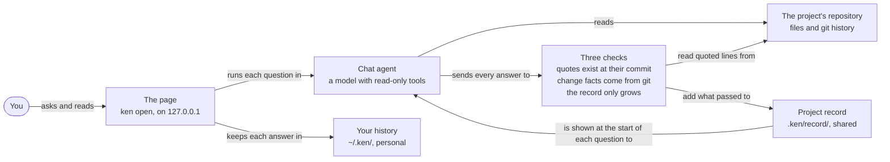

# ken

ken explains a software project to the developer who owns it. It tells you what changed, why it changed, and how a part of the code works now. It is built for projects where AI agents write most of the code.

## Status

Slices 0 to 3 of [the plan](docs/plan.md) run: a chat in the terminal about one repository, a project record, and a page in the browser. The model reads the files and the git history with tools that cannot change the project. It must send its answer through a tool that checks every quote against git, and it gets three tries. An accepted answer lists the commits in scope, read from git, and the changed lines that no quote covers. A question about a branch counts only what the branch did since it split from main.

The project record keeps what earlier answers found: pieces of work, the decisions in them, topics, and a note on each topic. It lives in `.ken/record/` in the project's repository, as one JSON Lines file per kind (`work.jsonl`, `decisions.jsonl`, `topics.jsonl`, `notes.jsonl`). ken only adds lines to it, and only through checks: every quote must pass, and commits and authors come from git. Every decision carries the label "inferred", because the model worked it out from the diff. Each question starts by showing the model the record, so asking again reads the stored answer instead of exploring again. ken never commits. You commit `.ken/` yourself, so a collaborator and their agents can read it.

Slice 3 adds the page. `ken open` starts a server on your machine and opens the page in your browser. You ask in a box at the bottom. While the agent works, the page shows each step it takes in plain words, and a Stop button. The answer comes as statements, each with its label and the code it quotes; open a quote to read all its lines. Beside the answer, ken shows what it checked: the quotes, the changed code that no quote covers (as diffs), and the commits, all read from git. The page keeps every question you ask, with its answer, in `~/.ken/projects/<first commit>/history.jsonl`. That file is yours and stays out of the project. Come back the next day and the page shows the answers again without asking the model.

A high-level question, such as how the parts fit together or what happens when a request comes in, gets an answer that leads with one or two basic diagrams: boxes and arrows, the steps of a sequence, or the data and how it relates. The model sends the boxes and arrows as data, never diagram syntax. Every arrow must quote the lines that show it, and those quotes pass the same check as any other. ken writes the Mermaid text itself, and the page draws it. Under each drawing, a numbered row for each box and arrow shows the lines it quotes. ken checked that those lines exist. It did not check that an arrow is true, just as it does not check a sentence.

How ken works today:



`ken chat` and `ken ask` take the place of the page in the terminal. They print a diagram as its numbered rows, and `--json` carries its Mermaid text.

## Run it

ken sends your project's code to the model you name, so it has no default model. Set three variables, in the environment or in `.env`:

```sh
KEN_MODEL=glm-5.3                     # the model to ask
KEN_BASE_URL=https://ollama.com/v1    # its OpenAI-compatible endpoint
KEN_API_KEY_ENV=OLLAMA_API_KEY        # the name of the variable that holds the key
```

Then, from this checkout, open the page, chat about the repository in the current folder, or ask one question:

```sh
npm run ken -- chat
npm run ken -- ask "What did this branch do?" --repo ../my-project --json
```

`ask` prints the answer and exits with code 0 when the answer passed the checks. `--json` prints it as one JSON object for scripts, with the entries it added to the record under `recorded`.

`record` shows the project record and needs no model. It lists pieces of work and decisions first. Give an id to see one entry in full, with its quotes; for a topic it also says whether the note still matches the code.

```sh
npm run ken -- record --repo ../my-project
npm run ken -- record 3f9a2b1c4e5d --repo ../my-project --json
```

`open` starts the page for the repository in the current folder, or the one you name, and opens it in your browser. It prints the address too, in case no browser opens. Press Ctrl-C to stop it. With no model set, the page still opens: it shows your earlier answers and says what to set. Ask how the parts of a project fit together and the answer leads with a diagram; choose a numbered row, or a box or an arrow in the drawing, to read the code it rests on. The page draws with Mermaid, which ken serves from its own address.

```sh
npm run ken -- open
npm run ken -- open --repo ../my-project --port 4242
```

The server listens only on 127.0.0.1 and answers only its own page. It runs one question at a time. Set `KEN_HOME` to keep ken's own files somewhere other than `~/.ken`.

After a session, commit the record in the project: `git add .ken && git commit -m "chore: update the ken record"`.

## Develop

You need Node 22.19 or later. Node runs the TypeScript files as they are, so there is no build step.

```sh
npm ci
npm run check
```

`npm run check` is the one gate, in CI and on your machine. It type-checks, lints, checks the formatting, and runs the tests. It also runs two checks of ken's own:

- `npm run check:structure` checks the folders in `src/` against the module table at the top of `scripts/check/structure.ts`.
- `npm run check:prose` fails on the em dash, curly quotes, and a list of stock words that mark machine-written text.

`npm run format` fixes the formatting.

## Agents

Coding agents that work in this repository follow [AGENTS.md](AGENTS.md).
