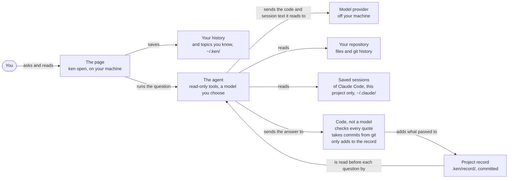

# ken

ken explains a software project to the developer who owns it. It tells you what changed, why it changed, and how a part of the code works now, and each claim in its answer quotes lines you can check. It is built for projects where AI agents write most of the code.


Screenshot of ken's own page. The model was Claude Opus, through ken's local endpoint. It shows the first of three risks in ken's answer to "What did the last commit do, and why?" about this repository at commit 5d4efe5, the commit that removed the cap on risks.

## Status

Early work. ken is not released, it has no license yet, there is nothing to install from a registry, and the repository is private. You run it from a checkout. [site/](site/index.html) holds a public page about it, not yet published.

What runs today:

- `ken open` starts a page on your machine, and `ken chat` and `ken ask` answer in the terminal. `ken record`, `ken map`, `ken follow-up`, `ken who`, `ken since`, `ken catch-up`, `ken area`, `ken decide`, `ken sessions` and `ken live` are described under [Run it](#run-it).
- An answer has a short summary, one or two basic diagrams for a high-level question or a change that touches two or more parts, then the decisions with their reasons, the risks, and statements. Each carries quotes of lines of code, of a commit message, or of a saved session of the coding agent. ken checks that every quoted line is where the quote says, and rejects an answer with a quote that is not there. It does not check that a sentence, a risk or an arrow is true, and it does not check the summary. ken shows no answer that fails the check: the agent tries again, up to three times. The commits, authors and dates, and which changed blocks and commit messages the quotes cover, come from git.
- For a question about a change, ken searches the code at the head commit for the names the change defines, alters or removes, and gives the model the places that use them, under "Used elsewhere". After the first answer passes, ken asks the model for a second look at its risks: read the code each risk points at, ask what happens when two decisions touch the same thing, and put the risks in order, heaviest first. ken keeps every risk the model sends. ken marks each risk "Quotes code outside the change" or "Quotes only the changed lines". ken checks where the quote is, not whether the risk is true.
- ken sets a label where it can. "Recorded" means a coding agent logged the decision with `ken decide` as it worked, or the reason is quoted from a commit message. "From the session" means the reason is quoted from a saved session. "Inferred" means the agent worked it out. "Found by search" marks a link between pieces of code that the agent found by searching and did not prove.
- The project record lives in `.ken/record/` in your repository, as JSON Lines files that ken only adds to. You commit it, so a collaborator and their agents can read it. ken never commits, and never writes to your project besides `.ken/`. Your question history and your understanding map live in `~/.ken/projects/<first commit>/` on your machine.
- The understanding map keeps what you said you know, topic by topic. A topic you know whose quoted code has not changed shortens to one line. When the code changed, the answer starts with what changed. "Waiting on you" lists the decisions that need your call and the topics that changed since you understood them, with who changed them. You answer a decision with "Keep what was chosen" or "I want it changed". ken saves your answer and note, and changes no code. "Decisions" lists every decision in the record, and a later decision on the same question replaces the older one.
- Live mode runs beside your coding agent and writes short notes as the work moves, on each commit and on uncommitted work that has gone quiet. ken finds each note's quotes. It does not check the note's words. For uncommitted work it keeps snapshots in its own store under `~/.ken/` and never writes to the project, so such a note is a draft on your machine. Live mode is off until you turn it on, and it shows what it spends.
- ken reads the sessions Claude Code saves. Before any session text reaches the model, the page, your history or the record, ken hides what looks like a credential. This is best effort: a secret written in plain words, or a short one, gets through. The record keeps only the quoted lines of a session, so commit `.ken/` only if you are happy to share them. Set `KEN_SESSIONS=off` to stop ken reading sessions.
- ken works with any OpenAI-compatible endpoint, and the code and session text it reads go to that provider. It has been run on glm-5.3 and kimi-k3.1-pro through Ollama Cloud, and on Claude Opus through the Claude Code command with ken's local adapter, `npm run claude-endpoint`. gpt-oss:120b, as served on Ollama Cloud in November 2026, could not follow the quoting rules.

Not built: readers for other coding tools' sessions, anything for teams, and a parser or index of the code.

### How ken did in its test

ken's plan sets a rule for its test: against a plain chat, ken must win at least one of three counts and lose none. The counts are finding more, trust without the diff, and finding it again. Finding more means the answer names a decision or a risk the other answer missed. Trust without the diff means the quotes let you trust the answer without opening the diff. Finding it again means you can find the answer the next day.

For real merged pull requests of another project by the same owner, ken and a plain chat with a coding agent on Claude Opus got the same question: "What did pull request #N do, and why was it done that way? Name the decisions it made and any risk I should know about." A second AI agent, fresh each time, scored each round against the code. The owner has not scored any of it.

ken won trust without the diff and finding it again in every round, on both models. Finding more went like this:

- Rounds 1 to 3 ran ken on glm-5.3, then on Claude Opus, against the plain chat on Claude Opus. Rounds 1 and 2 used three pull requests, and ken was tuned on these three. Round 3 added two more. ken lost finding more in every round.
- Round 4 added the "Used elsewhere" list and the second look at risks. With Claude Opus on both sides, ken passed on the three tuned pull requests for the first time, with a tie on finding more. It failed on the two others, and lost finding more on one of them. On three pull requests it had never seen, it passed narrowly, with a tie. With ken on glm-5.3, those three failed.
- Round 5 made the second look read the code each risk points at and ask what happens when two decisions touch the same thing. It also put the risks in order and added ken's marks on risks. With Claude Opus on both sides, three more pull requests ken had never seen passed. Finding more was a tie on two and a narrow win for ken on one, and the judge said a count of finds gives a tie, or ken by one. The three tuned ones passed. The two others failed narrowly on finding more, and so did the three that had passed narrowly in round 4. With ken on glm-5.3, the three newest passed, with a tie.

So ken does not find more than a plain chat. On finding more it is about level: sometimes a tie, sometimes a narrow loss, once a narrow win. The same three pull requests passed in one round and failed in the next, so one answer per pull request is a noisy measure, and a pass is not proof. ken's answers cost more. One took two to four minutes on Claude Opus and four to eight on glm-5.3, against one to three in the plain chat, and the second look takes about half of ken's input tokens. ken's answers are longer, and the plain chat reads faster. In round 5, one of ken's risks was false and carried the mark now named "Quotes code outside the change". ken checks where the quote is, not whether the risk is true. Every pull request came from one repository, and one AI judge scored each round.

A last check on three more pull requests ken has never seen, #107, #93 and #92, is still running. Its result will go here.

The verdicts are in [docs/checkpoint/](docs/checkpoint/): `round-1.md` to `round-3-same-model.md` for rounds 1 to 3, `round-4.md`, `round-4-unseen.md` and `round-4-unseen-glm.md` for round 4, and `round-5.md`, `round-5-second-three.md`, `round-5-unseen.md` and `round-5-unseen-glm.md` for round 5.

How ken works today:



The public page in `site/` draws the same parts and arrows.


Screenshot of an earlier note in ken's Live view for a small made-up project.

## Run it

ken sends your project's code to the model you name, so it has no default model. Set three variables, in the environment or in `.env`:

```sh
KEN_MODEL=glm-5.3                     # the model to ask
KEN_BASE_URL=https://ollama.com/v1    # its OpenAI-compatible endpoint
KEN_API_KEY_ENV=OLLAMA_API_KEY        # the name of the variable that holds the key
```

Then, from this checkout, open the page, chat about the repository in the current folder, or ask one question:

```sh
npm run ken -- chat
npm run ken -- ask "What did this branch do?" --repo ../my-project --json
```

`ask` prints the answer and exits with code 0 when the answer passed the checks. `--json` prints it as one JSON object for scripts, with the entries it added to the record under `recorded`.

`record` shows the project record and needs no model. It lists pieces of work and decisions first. Give an id to see one entry in full, with its quotes; for a topic it also says whether the note still matches the code.

```sh
npm run ken -- record --repo ../my-project
npm run ken -- record 3f9a2b1c4e5d --repo ../my-project --json
```

`decide` logs one decision in the project record, for a coding agent to call while it works. It needs no model. ken labels the decision "recorded", because it was written down when it was made, and keeps the name given with `--by`. The decision goes through the same checks as every other entry. A quote names lines of committed code, at HEAD or with `@<commit>` after it. A decision may also quote nothing, since it often comes before its code. Long text is safer as JSON on standard input, with the same fields; `ken decide --help` lists them.

```sh
ken decide --question "How long does a retry wait?" --chosen "A fixed 100 ms" \
  --reason "No caller needs more yet." --rejected "Exponential backoff: nothing calls for it" \
  --undo easy --quote src/retry.ts:12-14 --by claude-code
ken decide --json < decision.json
```

To let the agents in your other projects call it, run `npm link` once in this checkout: that puts `ken` on your PATH. Then add this paragraph to each project's `AGENTS.md`:

```markdown
**Log decisions with `ken decide`.** Run it the moment you choose between real options, leave a choice for the owner, or do something hard to undo: give the question, what you chose and why, and each option you rejected with its reason. Add `--needs-owner` when the owner should decide, and `--by` with your name. `ken decide --help` shows the rest. A choice with one obvious answer needs no entry.
```

A decision logged before its code is committed has no piece of work yet. Later, the piece of work whose commits start at, or pass through, the commit that was checked out when the decision was logged takes it in. `ken record <id>` shows which.

`sessions` reads the sessions Claude Code saved while it worked on the project, and needs no model. With no id it lists them, newest first: when each started and ended, and how many messages it holds. With an id it prints one session in order: what you asked, what the agent said, and each tool the agent ran on which file or with which command, with the first lines of its output. ken only reads these files. It reads only sessions that started in the project's folder or one inside it, at most the newest 100, and at most 32 MB of each.

```sh
npm run ken -- sessions --repo ../my-project
npm run ken -- sessions 0b7e4c2a-5f1d-4c3e-9a8b-2d6f1e0c9b7a --repo ../my-project --json
```

Claude Code keeps sessions in `~/.claude/projects/`. Set `KEN_CLAUDE_PROJECTS` to read them from another folder.

The chat and the page read the same sessions. The agent can list them, read one around a time or a message, and search them, and it quotes them only to say why something was done. `KEN_SESSIONS=off` turns reading off for `sessions`, the chat and the page.

`map` prints your understanding map and the path of its file. It needs no model. To correct the map, add a line to that file; `map` shows the hash each topic has now, and an example line to copy. `catch-up` lists, without a model, the topics whose code changed since you understood them and the work recorded since your last question, then asks the agent to explain them. `area` does the same for one part of the project. With no model set, both still print their list.

```sh
npm run ken -- map --repo ../my-project
npm run ken -- catch-up --repo ../my-project
npm run ken -- area src/server --repo ../my-project
```

`follow-up` prints what is open: the decisions that need your call, and the topics you understood whose code changed since, with the commits that changed them. `who` lists one author's commits, named by email or part of a name, and the topics you know that they touched. `since` lists what landed in a span for everyone, with the pieces of work the record has in it. A span is a day such as `2026-11-01` or a number of days such as `14d`; `who` uses the time since your last question unless you give `--since`. Each prints its list without a model, then asks the agent when a model is set. When the list holds nothing to explain, it asks nothing.

```sh
npm run ken -- follow-up --repo ../my-project
npm run ken -- who bo@example.com --since 14d --repo ../my-project
npm run ken -- since 2026-11-01 --repo ../my-project
```

`open` starts the page for the repository in the current folder, or the one you name, and opens it in your browser. It prints the address too, in case no browser opens. Press Ctrl-C to stop it. With no model set, the page still opens: it shows your earlier answers and says what to set. The page draws diagrams with Mermaid, which ken serves from its own address. Under each answer, "I know this", "Too much" and "Go deeper" update your map. The header links to "Decisions" and "Your map", to "Live" when a model is set, and to "Waiting on you" when something waits on you. The lenses sit under the question box: catch up, an area, and what changed, by one person or by everyone, in a span you pick.

```sh
npm run ken -- open
npm run ken -- open --repo ../my-project --port 4242
```

`open --live` starts the page with live mode on; the "Live" view's switch turns it on and off too. `live` runs it in the terminal instead: it prints what it sees now, then each note as ken writes it, until Ctrl-C. Both need a model, and each note is one question to it. "Pause" holds the notes, "Write a note now" asks for one at once, and "Open as a question" on a note asks for the full answer on that change.

```sh
npm run ken -- open --live --repo ../my-project
npm run ken -- live --repo ../my-project
```

The server listens only on 127.0.0.1 and answers only its own page. It runs one question or live note at a time. Set `KEN_HOME` to keep ken's own files somewhere other than `~/.ken`.

After a session, commit the record in the project: `git add .ken && git commit -m "chore: update the ken record"`.

### Run ken on Claude through Claude Code

If you have no hosted model to hand, ken can use the Claude Code CLI on your machine. A small endpoint in `scripts/claude-endpoint/` speaks the chat-completions protocol to ken and answers each request by running `claude -p` once. It needs `claude` on the PATH and signed in. It needs no API key.

1. In one terminal, start the endpoint. It listens on 127.0.0.1, port 4141 unless you give `--port`:

   ```sh
   npm run claude-endpoint
   npm run claude-endpoint -- --port 4242
   ```

2. In another terminal, set these four variables, in the environment or in `.env`, and use ken as usual:

   ```sh
   KEN_MODEL=opus                          # passed to claude --model: an alias or a full model id
   KEN_BASE_URL=http://127.0.0.1:4141/v1   # the endpoint
   KEN_API_KEY_ENV=KEN_LOCAL_KEY           # ken needs a key variable of 8 characters or more
   KEN_LOCAL_KEY=not-a-key                 # any text: the endpoint ignores it
   ```

No key leaves your machine on this path. What does leave it is everything ken sends the model: its instructions, the questions, and the code and history it reads. That goes to Anthropic through your Claude Code sign-in, and counts against your Claude plan.

The CLI runs as a plain model, not as a coding agent: in an empty folder, with its built-in tools switched off, no settings or instruction files, no MCP servers, and no saved session. ken's tools are described in the prompt, and the model sends its tool calls back as structured output. The endpoint answers one request at a time and prints how long each `claude` run took.

It is slower than a hosted endpoint. Each turn starts the CLI again, which costs about a second before the model starts, and resends the whole conversation. ken gets each turn whole, when the `claude` run ends.

## Develop

You need Node 22.19 or later. Node runs the TypeScript files as they are, so there is no build step.

```sh
npm ci
npm run check
```

`npm run check` is the one gate, in CI and on your machine. It type-checks, lints, checks the formatting, and runs the tests. It also runs two checks of ken's own:

- `npm run check:structure` checks the folders in `src/` against the module table at the top of `scripts/check/structure.ts`.
- `npm run check:prose` fails on the em dash, curly quotes, and a list of stock words that mark machine-written text.

`npm run format` fixes the formatting.

## Agents

Coding agents that work in this repository follow [AGENTS.md](AGENTS.md).
