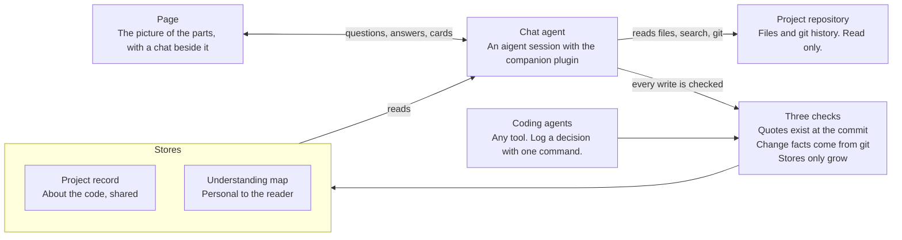

# Plan: a code companion that explains a project to its reader

As of 2026-11-18

## Summary

The companion is a local tool that explains a software project to the one developer who owns it, at the depth that developer needs. It answers three kinds of question: what changed, why it was done that way, and how a part works now.

It is built for projects where AI agents write most of the code. The developer comes back after hours or weeks, or works beside someone else, and needs to understand the project again without reading every diff.

The developer opens a page that shows the project as a picture of its parts, picks how much detail to read, and says how they want it shown. A chat sits beside the picture for questions it does not answer. The model replies in its own words, as a colleague would, and shows a card with the quoted code for each claim that needs proof. The page keeps the questions as a thread, so it becomes the record of what the developer now understands.

It is a new repository. The only code it reuses is `aigent`, the owner's agent engine, which runs the chat. It has no parser and no code index: an agent explores the code with read, search and git, and three small deterministic checks keep its claims honest.

The first version must prove one thing: that an explanation from this tool is more useful than asking a coding agent "what changed and why" in a plain chat. If it is not, stop and rethink before building further.

## The problem and what exists

Agents now produce code faster than a person can absorb it. The gap has a name, comprehension debt. Margaret-Anne Storey splits it in two: cognitive debt (what the team understands) and intent debt (reasons that were never written down). An Anthropic trial found that developers who used AI assistance scored about 50% on a comprehension quiz, against 67% for those who coded by hand.

No single product closes this gap for the reader. A search on 15 November 2026 found six groups of tools, each covering one part.

| Job                               | Examples                                                       | What it lacks                                                                          |
| --------------------------------- | -------------------------------------------------------------- | -------------------------------------------------------------------------------------- |
| Record what the agent did and why | Entire, SpecStory, Git AI, Agent Trace, Agent Decision Records | A transcript or a log to read, not an explanation                                      |
| Make one change readable          | Stage, Haystack, Graphite Code Tours, Devin Review             | One pull request at a time, the same text for every reader, reasons guessed afterwards |
| Explain a codebase                | DeepWiki, Google Code Wiki, Codemaps, Understand-Anything, xpl | A picture of the code now: no history, no decisions, no memory of the reader           |
| Teach while coding                | Claude Code's Explanatory and Learning styles                  | Only inside the live session                                                           |
| Check the reader understood       | Quiz gates such as SlopBlock and pr-quiz; LACY (research)      | A gate before merging, not a guide                                                     |
| Measure who knows what            | CodeScene, degree-of-knowledge models                          | Based on who wrote the code, which means little when agents write it                   |

Four things are missing everywhere, and this product is built around them:

1. A lasting model of what this reader already understands.
2. Decisions as records: what was chosen, what was rejected and why, written down when the decision is made.
3. Views that are not tied to one pull request or one point in time.
4. Claims checked against the code, so an explanation cannot cite code that is not there.

The recording side is crowded and moving fast. The reader side is open.

## Decisions already made

These were settled in the design discussion. An agent working on the project should treat them as fixed unless the owner changes them.

| Decision                                  | Reason                                                                                                                                                                                   |
| ----------------------------------------- | ---------------------------------------------------------------------------------------------------------------------------------------------------------------------------------------- |
| One developer first, not a team           | It keeps the reader's model to one local file and needs no accounts or sharing. A collaborator's changes must still be handled, because the owner sometimes works beside someone else.   |
| A new repository                          | Nothing is reused from xpl or own-your-diff. Their ideas carry over; their code and data models do not.                                                                                  |
| `aigent` is the chat engine               | It is the owner's own engine, and it runs on any model provider, including open-weight models.                                                                                           |
| No tie to one coding tool                 | The code may be written by Claude Code, Codex, a collaborator or the owner. Git is the only source every case shares.                                                                    |
| No parser and no code index at the start  | An agent explores with read, search and git. This works for every language and file type from the first day, and a parser per language is a large cost to pay before the idea is proven. |
| A picture first, with a chat beside it    | The owner asked on 2026-11-22 for a dashboard in place of the chat-first page. The developer still asks questions, and the questions are still the main signal of what they know.        |
| No single "since last time" cursor        | It assumes one reader and nobody else changing the code. It fails with a collaborator and after weeks away. Time is one way to scope a question, not the centre of the design.           |
| High-level answers lean on basic diagrams | The owner asked on 2026-11-15 for high-level answers that lean on basic diagrams. Detail stays prose with quotes. A diagram is checked data, so it cannot show code that is not there.   |

## The model

The design has two stores and a set of lenses. A lens picks a part of the project record; the understanding map decides how deep the answer goes.

### The project record

The project record is about the code and is the same for every reader. It holds five kinds of entry.

| Entry         | What it holds                                                                                                                              |
| ------------- | ------------------------------------------------------------------------------------------------------------------------------------------ |
| Piece of work | Commits that belong together (a task, a branch, a pull request), who did it, when, and a short summary                                     |
| Decision      | The question, the option chosen, the options rejected with a reason each, how easy it is to undo, and whether it needs the owner's opinion |
| Topic         | A named part of the project, such as "retry logic", with the quoted code it rests on                                                       |
| Note          | The agent's cached summary of a topic, stored with the hash of the code it describes                                                       |
| Layout        | One level of the project's parts as ken's model named them: each part's name, job and paths with git's id of each, and the quoted arrows   |

"Who did it" is one of: the owner, the owner's agent, a collaborator, or unknown. Git tells the owner from a collaborator. It cannot always tell the owner from the owner's agent, so the record says "unknown" when it has no evidence.

### The understanding map

The understanding map is personal. It has one entry per topic the reader has met. Each entry holds:

- the topic;
- a depth: has heard of it, can follow it, or could change it;
- the evidence: asked about it, read its card, met it on a tour, said "I know this", or wrote it by hand;
- the date;
- the hash of the topic's quoted code at that moment.

The hash is what replaces the cursor. When the code under a topic changes, the entry is marked "changed since you understood it", whoever made the change and whenever it happened.

The map is a plain file the reader can open and correct, because it will sometimes be wrong. A question asked is evidence of interest, not proof of understanding.

### What the reader looked at

The map learns only from what the reader says: a question, a button, a tour stop. A part with no topic has nothing. So ken also keeps what the reader looked at, in `seen.jsonl` beside the map: a plain file on their machine that only grows, which they can open and correct. The page sends a line as the reader moves, and ken stamps it with the time and with HEAD. Each line says what they did and the paths they looked at:

- `opened`: they picked the part;
- `read`: they stayed on its explanation, or moved on from its tour stop;
- `code`: they opened its files, quoted lines or a diff;
- `said`: they pressed "I know this part";
- `forgot`: they said they do not know the part, which is the same as setting it to `seen`;
- `change`: they read a step or a diff of a change that touched the paths. It keeps the change's range;
- `set`: they pressed "Not right" and picked one of the five levels below. It keeps the level and takes the place of every line before it for those paths. Only "I know it" says they know the part as it is now. Any other level leaves the count of commits since they looked as it was;
- `undo`: they took back one line of what ken recorded. It names that line by its time and has no paths. The line stays in the file and counts for nothing.

A line counts for a box when one of its paths is the box's path or inside it. From the lines that count, and from the map's topics in the box, plain code gives every box one level, the strongest thing the reader did there:

| Level  | On the page          | What put the reader there                                                           |
| ------ | -------------------- | ----------------------------------------------------------------------------------- |
| `new`  | New to you           | Nothing yet                                                                         |
| `seen` | Seen                 | Opened the part, or read a change that touched it                                   |
| `read` | Read                 | Stayed on its explanation, moved on from its tour stop, or asked ken about it       |
| `code` | Read the code        | Opened its files, quoted lines or a diff                                            |
| `said` | You said you know it | Pressed "I know this part", or said "I know this" on every topic ken has in the box |

Beside the level the box says why, in one sentence built by code that names what the reader did and the day. It says the day they last looked, and how many commits, merges left out, touched the box after the commit they last looked at. A box they looked at that commits touched since is stale. When history was rewritten and that commit is gone, the count is 0 and the sentence says ken could not find the commit.

The box also says where ken would open the part for this reader: a part new to them at its job, one they have seen at how it works, one they have read at the code, and a stale one at what changed since they looked. The list of what to look at next reads the same answer, so a box and its item cannot disagree.

Looking is never understanding. ken says the reader read a part or opened its code. It says they know a part only when they said so.

Opening a part does not move the commit they last looked at: only reading does. For a change the reader walked through, that commit is the change's own last commit when HEAD has it. Of all the lines that move it, the one at the newest commit counts, so walking through an older change does not undo having read the part at HEAD. The map keeps a day and no commit, so for a box that only the map speaks of, ken counts from where the reader's understanding of a changed topic starts.

These lines also order what the page offers next, at most five things: the decisions that wait on the reader, each stale box with the most commits first and then the most lines, the reader's own work or the newest merge they have not walked through, a stale box with one commit unless they said they know it, the next stop of the tour, then the parts they never opened. No model takes part.

### Reader notes

A reader note is one plain sentence ken keeps about the reader: how they want things shown, or what they already know. The model writes it to the reader, since the page shows it to them: "You are new to TypeScript, so I explain language features as they come up." The notes are personal, so they sit beside the map, in a plain file that only grows. A line adds a note, and another line removes it by its id.

The model keeps a note with the `remember` tool when the reader says how they want to be answered. It keeps how they want to be answered, never what they asked about. Every question then starts with the newest twelve notes. The page lists them, and the reader can remove any of them. When a note says the reader is new to a language or a tool, the model explains a feature of it once in a thread, in one sentence, in the card whose quoted lines contain it, and never with an example that is not in the code.

Beside the notes ken keeps one choice of the reader: how much text they want. It is one of three: pictures first, balanced, or more words. It lives in `prefs.json` beside the map, and a reader who never chose starts on pictures first. The page shows more or fewer words by it, and every run tells the model the choice in one plain sentence, after the notes.

### The project's layout

The owner asked on 2026-11-17 for ken to "show me the state of the repo architecture-wise at any point and zoom in on the feature, change etc I am doing", and for a guide that "shows me data I want to follow", lets them look closer when they want, "and makes a model of what I know about it". The layout is that view, and it is the page's home.

- **A level is a few boxes over paths.** With nothing drawn, plain code splits the level's scope by its next folder: the five largest folders by file count, one "N more folders" box for the rest, and one box for the files that sit right in the folder. A box opens the level whose scope is its paths, so zooming in is a lookup and nothing has to be kept in step.
- **A picture on a wide screen.** Where the picture has room, 680 pixels on the home, the boxes sit in a grid of up to three columns, placed by trying every cell: a part that uses another sits above it where it can, the part with the most arrows goes to the middle, and an arrow through a box or across another arrow costs more. The arrows are drawn between the boxes with their heads, each with the number of its row in the list beside the picture, and a click on an arrow opens the line it rests on. On a narrow screen the boxes stand in one column, ordered so the fewest arrows cross, and each arrow bends out to the right of the column with its number on it. A label sits beside its arrow's line where there is room. It covers no box, no other label and no arrow's head, and at most half of its own line. A label that finds no such place shows its number alone. An arrow that is not part of the selection or the change is dashed and thinner, never fainter. To a screen reader the boxes and the arrows are two lists.
- **Any commit.** The boxes are the folders at HEAD, or the named parts that fit the commit best. At another commit, git's own ids say which boxes hold the same content as now, which are different then from now, and which are not there yet. What sat in the scope then and in no box now is named.
- **A change laid over it.** A range, a branch from where it left the main branch, one commit, or the reader's uncommitted work, through live mode's snapshot. With no change asked, the view shows where the reader is: their uncommitted work if there is any, else the branch HEAD is on against the main branch, else nothing. Another change sits behind "Another change", and the project at an older commit behind "See the project at an older commit". A change can also be asked as a span of time, `since:14d` or `since:2026-11-01`, and a span with no commit is refused. Each box shows the files it touched and the lines added and removed, and lists up to 20 of them with their own counts. A changed file in no box is named. Inside a part, the change counts only the files under that part. The change lists its commits, newest first and without merges, up to 50. The page can ask for the diff of up to 10 of its files, as hunks with their line numbers, cut after 400 changed lines. All of it comes from git, with no model.
- **The reader's map on each box.** Each topic in the record sits in the boxes that hold a file it quotes. Each box says what ken thinks the reader knows of it, as "What the reader looked at" describes, and gets one standing from that same answer: the reader said they know it and commits touched it since, they never looked at it, they looked and have not said they know it, or they said they know it. The box's line and the one line over the view are written from that standing, so they never disagree. The line over the view names where to look next: first the boxes that changed since the reader said they know them, then the boxes they never looked at, then the ones they have not finished.

- **ken's model names the parts.** "Ask ken to name these parts" on a folder level sends a question into the reader's thread with the folder split as the starting point and the layout rules. The model reads the project's own maps first (the README, design docs, a glossary, a table of modules) and sends `show` with a layout: 2 to 6 parts, each a name the owner would use, a one-sentence job and its paths, and at most 8 arrows. The rules ask it to file a file by what it does and not by its folder, to spend the parts on the code a user runs, with one part at most for what only keeps the repository going, and to draw the relation that matters when the code runs, with a verb that says only what its quoted lines show. ken checks it like any card, and a layout that fails goes back alone. Every path must hold a file at the commit and sit inside the level, and no two parts share a file. Every arrow quotes lines from a file of the part it starts at, and those lines name a folder or file of the part it ends at, as an import line does. Lines that are all comments do not count: a line whose trimmed start is //, /*, *, #, -- or ; is a comment, except C's #include and #import. ken checks the quote in git and the name by plain text, with no parser. An arrow the model cannot quote that way is left out: no arrow is a guess.
- **Every version is kept.** A named level is a `layout` entry in the record, with git's id of each path at the commit it was named at. A new one replaces the one before and the old one stays. At the commit checked out the view shows the newest version, so a level drawn again with fewer parts shows as drawn. At an older commit it picks the version with the largest share of its parts the same there by those ids, the newest on a tie. With none, it shows the folder split.
- **Shown another way on request.** The reader can tell ken to show a level another way, in their own words. The question carries those words, the level as it stands and the layout rules. When the words are about the picture, the model sends a new layout, and ken stores it with the reader's words beside it. Plain code sets those words, and the model has no field for them. When the words are about the reader, the model keeps a reader note instead. A picture the model sends must say what the level is, who uses it and the one idea its maintainer would say first, in a sentence or two. A picture stored before that rule may have none.
- **A drawn picture.** Some requests are not a grouping of parts: follow one request, a data flow, a lifecycle. For those the model sends one checked diagram instead: a sequence, a component or an entity-relationship diagram. ken keeps it in the reader's history with the level and the reader's words, and the home shows it beside the parts.
- **Back to the picture before.** ken finds the picture that shows at the commit checked out and the newest one before it whose parts or arrows differ. It appends a copy of that earlier one, which is then the newest and shows. Nothing is deleted, and going back once more brings the redraw back.
- **It says when it no longer fits.** A part whose ids differ from when it was named says so, one line over the view says the arrows that start at it may be out of date, and a folder that is new and in no part is named ("src/extra is new and in no part"). The view says who named the parts and at which commit, and offers "Name them again".
- **The model speaks in the reader's names.** Each question's first message lists the top named level, one line per part, so the model's words use the parts the reader sees.

Looking at the layout takes no model: each look reads git, the record, the map and what the reader looked at again. Only naming a level, or drawing it again, asks the model.

This touches "no code index". The layout is not an index: it is a few folders per level, read from git when the reader looks, with no symbols, no call graph and no cache. A drawn level adds a few named boxes and quoted arrows, still not an index of the code.

### Lenses

| Lens              | Question it answers                               |
| ----------------- | ------------------------------------------------- |
| Catch up          | What differs from what I understood               |
| A piece of work   | What did this task, branch or pull request do     |
| A person or agent | What did my collaborator change                   |
| An area           | What do I need to know to work in this part today |
| A decision        | Why is it this way                                |
| A time range      | What happened in the last two weeks               |
| Explain           | What is this part, in a few things to know        |
| Answer            | One question about one concept, as a brief        |

### How the depth is chosen

| State of the topic for this reader | What the answer does                                             |
| ---------------------------------- | ---------------------------------------------------------------- |
| Never met                          | Explains from the top in a few sentences and offers to go deeper |
| Understood, code unchanged         | Collapses to one line                                            |
| Understood, code changed           | Leads with what changed against what the reader knew             |
| Understood long ago                | Gives a short reminder first, then the changes                   |

When many topics have changed at once, such as after weeks away, the answer starts one level up: a summary of the whole, then the topics ranked by how risky and how new they are to this reader.

### Signals that update the map

- A question marks its topic as a gap. Its wording sets the level: "what is a write-ahead log" and "why sync per batch" call for different answers.
- Three buttons on every answer: "I know this", "too much", "go deeper".
- Code the reader wrote by hand counts as understood, when the record knows it was by hand.

## What stays deterministic

The agent explores freely, but three things are never left to the model. None of them needs a parser.

1. **Quotes are checked.** Every claim about code cites a file, a commit and the exact lines it relies on. A checker confirms that this text exists in that file at that commit. A card with a bad quote goes back to the model alone, and the reader never sees it. The rest of the reply stands. The model's own words are not checked, and the page says so once, at the top of the thread.
2. **Change facts come from git.** What changed, who changed it and when are read from git, never recalled by the model. The tool also computes whether every changed hunk in scope is covered by the explanation, and lists the ones that are not.
3. **The stores are append-only and written through tools.** The model adds a decision, a topic or an understanding entry by calling a tool that validates it. It never rewrites a store as free text. A correction is a new entry that replaces an old one, and the old one stays readable.

### A reply, as built

The model reads the project, then replies in its own words. It calls one tool, `show`, with the cards that need proof: claims, decisions, risks, diagrams and topics, and with a brief when the question asks for one. ken checks each card alone. A turn in which the model called a reading tool is its working, and the page folds it into the steps. A turn in which it only wrote, or wrote and showed cards, is the reply, its cards after its words. A turn that shows cards again after ken sent one back mostly says so ("sending it again without them"), so its words are a step too, unless no later turn writes words.

A reply about a change opens on the change card, which plain code draws when the model names the change with show's scope: the project's top level of parts, each part the change touched marked with its files and lines, any changed file in no part, and the commits. It needs no quote, so it cannot fail. Opening a part on it opens the home there with the same change laid over it. Then the model tells the story in two to five sentences of plain prose, with no list and no heading, and backs the main point with a card. It reads the code at the base commit before it says how things were before, since a commit message can be wrong about that. A question ken writes about a GitHub merge names it by its pull request number. It says in one line whether there are decisions or risks worth a look. The reader asks for them, with two chips under the reply or in words.

A third chip, "Walk me through it", asks for the change as three to seven steps in the order a reviewer should read them. The model sends each step with show's step: a number, at most two short sentences of its own, 40 words in all, and the claims that prove it. A step holds one thing. After the last step, one line names what the steps leave out and a reviewer should still open, or says they leave nothing out. A step whose card ken sends back still shows, and the card sent again under the same number joins it. Plain code links each step, never the model: its hunks are the change's hunks its quotes overlap, by the same rule as the coverage check, and are saved with the change; its parts are the parts of the top level its quote paths fall in, found by the page against the picture it draws. The page shows the steps beside the change card's picture. The step the reader is on lights its parts and opens its hunks as a diff with the line numbers before and after: in the panel on a wide screen, under the step on a narrow one. Pointing at a part lights the steps that touch it, and pointing at a quote lights its part. The picture keeps the home's layout for the same parts. On a phone it stands in one column with the arrows bent out to its right. When risks of a change arrive, ken holds them for a second look: in the same session, the model checks each risk against the code and the later commits on the same files. It may withdraw a risk only with a quote of the line that rules it out, and the reader still sees the withdrawn risk with that line.

Live notes run in a chat of their own, so a note never sits in the thread the reader talks in.

Besides the quote check, ken runs these checks. An entry that says something is missing or untested names the text that would be there, and ken searches the head commit for it and refuses the entry if it finds the text. A risk that quotes the message of a commit made after the change is marked "Fixed since".

### A tour of the project

The owner asked on 2026-11-18 whether a new user can onboard to a project easily with ken. The picture on the home is a map; a tour walks the newcomer through it.

- **"Ask ken to explain these parts"** sits on the Architecture canvas, and beside the picture of the views from before the pages, on any named level at HEAD that ken's model has not explained. It sends the explain lens for every part of the level. Inside a part, it explains that part's own named level. Until 2026-11-22 the button said "Show me around" and sent a lens called `tour`; the server no longer takes that name.
- **The tour follows the order of the parts.** ken's model lists a level's parts in the order a newcomer should read them, the heart of the product first, and ken checks and stores that list. Plain code only moves the parts that support the code to the end, in the order the level lists them. A part supports the code when its name or the first word of its job says test, build, scripts, vendored, tooling or upkeep, or when every one of its paths sits under such a folder. The same level always gives the same order. Until 2026-11-22 plain code walked the arrows instead: outermost part first, then inward. Two fresh reviewers found that put the product third, and no rule over the arrows found the heart: the most used part is often a small utility.
- **One model run for the whole level.** Until 2026-11-22 that run wrote a paragraph of at most 80 words for each stop, with one or two claims. It now writes a brief for each part: see "A brief for every concept". The order is still the tour's. A reply saved before the change keeps its paragraphs, and opens as briefs built from them.
- **A stop is a walkthrough step.** The same list, Next and Previous, arrow keys and panel. Its part is the stop's, not found from quotes; the panel shows the code its cards quote, not a diff. The picture is the level, in tour order on a phone.
- **The tour follows the map.** When the run ends, ken adds each stop's part to the record as a topic resting on the lines its brief quoted, unless the record has it. Asking for the run marks nothing. Reaching a stop adds a "toured" line for its topics, which counts as met, not understood; "I know this part" adds "said". A stop all of whose topics are met shows as seen.
- **A tour is a reply.** It is kept in the reader's history with its stops, and "Start the tour" opens the newest tour of the same level and stops again, with no model, at the first stop the reader has not seen.

### A brief for every concept

The owner said on 2026-11-22 how they take a project in: "reading a small description and definition, then go to architecture, then start going in more depth about it, questions about the general terms and/or a small questions around possible outcomes, decisions, and deep dives to the content". They think in pictures. The brief is that small description, and every concept has one.

- **A concept** is a part, a term, a drawn process, a step of one, a question, a decision or an arrow, and on the drawings of the top level a frame, a store, an outside system or a crossing. A part where nobody named the parts and git lists one file is a file, and its brief says so. The page and the server name each by one string, such as `part::Plugin engine`, `term:gate`, `question:<id>` or `frame:worker-thread`. `GET /api/brief?concept=<id>` answers with its brief, and an id ken does not know answers 404.
- **What a brief holds.** One line that says what the concept is. Three to five things to know. Its terms. A few questions worth asking, each with whether it has an answer. The decisions about it. Sideways: the parts it uses, the parts that use it, and the drawn processes that pass through it. Deeper: the level inside it. What ken thinks the reader knows of it. One sentence on trust: ken's model wrote the words, and ken found each quoted line in git.
- **A thing to know is a claim said three ways.** A line of at most ten words, one sentence that says it in full, and two or three sentences for a reader who wants words. It has a small drawing, and it rests on quoted lines of files, which ken checks as it checks any claim. The page shows the line, the sentence or the paragraph by the reader's choice of how much text.
- **The drawings are a fixed set.** The model picks one of seventeen kinds for each thing to know: steps, gate, swap, log, once, fanout, fanin, loop, queue, store, wall, clock, cut, eye, fork, link, and dot for none of them. It may add a count from 2 to 8, the step that is filled, and a label of at most 12 characters. The page draws each kind itself. The model draws nothing, so a brief cannot hold a picture that is wrong in its lines. A count or a label outside those bounds is left out and the kind stands.
- **A term is a topic of the record.** The model gives each term its name in the words people use for it, never a code name such as `toolMode` (the code's name is in the quote), what it means in at most twenty words, and one quoted line where the code uses it. ken stores it as a topic with that meaning as its note, so the reader's map and what ken thinks they know work for a term as they do for any topic. One name means one thing: a brief that names a term the record already holds keeps the meaning the record has.
- **Plain code builds what it can.** A part ken's model has not explained still has a brief: its job and arrows from the layout, the decisions whose quoted lines fall in its files, the drawn diagrams that pass through it, the level inside it and what ken thinks the reader knows. It also has up to three questions plain code writes from its arrows and its files, such as "How does Plugin engine run code in Sandbox?", and the page shows its arrows in words and what is inside it. A term the model has not explained opens with a line on where the project uses it, then what the record holds of its meaning. It says `explained: false` and carries the lens that asks for the rest. A drawn process, a decision and an arrow need no model at all.
- **The explain lens.** "Ask ken to explain it" on a part asks for that part, and on a level for every part of it, in one run and in the tour's order. The model sends one `show` call per part with `brief`. ken takes a brief apart into what it already checks: each thing to know is a claim and each term is a topic. So one thing to know whose quote is not in git, whose line passes ten words, or that quotes only comments goes back to the model alone, and the reader never sees it. The rest of the brief stands. A reply that explains several parts may have six cards sent back for each part.
- **The answer lens.** A press on a question, or a question typed in the box under them, asks ken's model one question about one concept. The answer is a brief too: one sentence, and three to five things to know. A question is named by its concept and its words, so it is the same concept before and after it has an answer.
- **Where a brief is kept.** A brief is a reply, so it lives in the reader's history, as a tour did, and opens again with no model. Its terms go into the record as topics. An answer lives in the reader's history too. The record has five kinds of entry and none can hold things to know with their drawings, so a collaborator who has the record has the terms and not yet the briefs or the answers. A sixth kind of entry is the owner's call.
- **In the terminal.** A reply that holds a brief prints it in the same order: the line, the things to know by number with the drawing named in words and the quoted lines, the terms, then the questions.
- **The model is told who reads.** The question says the reader thinks in pictures, asks for short literal words, and tells the model to pick dot when no drawing fits and never to change what a thing to know says so that a drawing fits it. It never writes that the reader understands something: it says what the code does.

Three more reads serve the pages around the brief, all with no model. `GET /api/concepts` lists what search can find: the parts of the top level and of every named level, the terms and the drawn processes. `GET /api/processes` gives each drawn diagram as lanes matched to the parts of a level and the messages between them, with the processes ken's model offered to draw. `GET /api/timeline` counts the commits of each day, merges apart, in UTC days as a change asked by `since:` uses.

### Where it runs and what it talks to

The owner asked on 2026-11-22 for the architecture drawn "how an architect would present technically the project": not only parts and arrows, but "boxes indicating separation of runtimes" and "putting things in context hierarchically". So the top level of a project has two more drawings beside its parts.

- **In its world.** The project as one block. Around it, the people and outside systems it deals with, each a person or a system with a name, one line on what it is, and the lines that show it. Between the project and each, a crossing: what crosses, how (http, https, grpc, sql, event, file, process, library or other), in which direction, and the lines.
- **Where it runs.** Frames, each a place code runs: a browser, a machine, a cluster, a process, a container, a thread, a virtual machine, a sandbox, a function or other. A frame sits in another frame or in none, so frames nest, and it says how many copies run when a line of the repository gives the number. Things sit in frames: a part of the level by its name (a part that runs in two places is two things), a store (a database, a cache, a queue, a bus with its topics, files or other) or an outside system of "In its world". A crossing goes from one thing to another: a call that waits for its answer, with how it crosses, or an event picked up later, with its topic, and the lines on each side where the repository has them. A gap says what the repository does not say about a thing, such as "who runs it: not in the repository" or "no reader in the repository".
- **Named in the run that names the parts.** When ken's model names the parts of the top level, the same run draws both, with `show`'s field `views`. A project named before this has neither, and the lens `{ kind: "views", within: [] }` draws them alone, in one run. ken refuses that lens until the parts are named, since a thing names a part. The question lists what plain code read from the deploy files, and tells the model to write a gap where it would otherwise guess.
- **Each item is checked alone.** Every item but a gap rests on one to three quoted lines of files, which ken finds in git at their commit. A part in a frame must be a part of the level. A frame must sit in a frame ken took, and frames form a tree, so two frames that sit inside each other are both refused. A crossing, a thing or a gap must name items ken took. An event that touches a store with listed topics must travel on one of them. An item that fails any of this goes back to the model alone, with its problems, and the reader never sees it. The rest stand.
- **What plain code reads, and holds the model to.** ken reads three kinds of deploy file with a small reader of its own, by indentation, with no YAML library: a compose file (`compose.yml`, `compose.yaml`, `docker-compose.yml`, `docker-compose.yaml`) for its services and `deploy.replicas`, a Kubernetes manifest for each Deployment, StatefulSet and DaemonSet with its name and `spec.replicas`, and where each Dockerfile is. A frame's copies must be on the line it quotes, and when that line sits in a service or a workload ken read, they must equal what the file says (one, when it sets no replicas), or the frame goes back. ken cannot read a template (Helm's `{{ }}`), a Helm chart or Terraform. It lists those in the question, and the model's quotes stand for them.
- **What ken does not check.** The kind of a frame, a store or a crossing is the model's word, held only to the lines it quotes: ken does not prove that a quoted `new Worker` makes a thread. ken cannot see what is only in a cloud console (regions, autoscaling as it runs, network rules), another repository unless it is given one, or traffic. Where the repository says nothing, the drawing says so with a gap.
- **Where they are kept.** The drawings are the field `views` of the top level's `layout` entry in the record, not a sixth kind of entry. A thing names a part of the same entry, so a part in a frame is a part of the level in every version. A newer version of the level replaces the older one as before, and the record checks every item again when it stores one. A layout stored before this has no such key, so its id stays what it was. A level named again without the drawings has none until they are drawn again.
- **What the page reads.** `GET /api/layout` gives `look.views` on the top level: `world` with the project's line, the outside systems and the crossings, `runtime` with frames, things, crossings and gaps, and `drawn`, the day ken kept them. Each is null until ken's model has named it. A part in a frame is named as its box is, so the page can draw it with the box's colour. `GET /api/brief` opens `frame:<id>`, `store:<id>`, `outside:<id>` and `crossing:<id>`: the line, the lines ken found, the crossings into and out of it as Sideways, and for a frame what sits in it and the parts in it as Deeper. `GET /api/concepts` lists frames, stores and outside systems.
- **How the page draws them.** Plain code on the page lays both out, with no positions from the model. "Where it runs" is a tree of frames laid out inside out: a frame's size comes from what it holds. A frame with nothing in it is not drawn. Inside a frame the things stand in rows: what calls stands above what it calls, a call that goes on from a short row stays in it, a bus has its own row under what reaches it by calls, and what only meets through the bus stands under it. A store one thing uses alone stands beside it. A store, an outside system, a bus or a smaller frame that only meets things inside one frame stands just outside that frame's edge, level with what it meets. A container, process or function that holds one part is drawn as that part, named after the container, with its copies. Lines go around blocks at right angles and keep clear of blocks they do not join, a ring marks where one crosses a frame's edge, only such a line carries a label, and no label covers a block. What the repository does not say is in the brief, not on the drawing. A frame of more than eight things folds those that share a name prefix or a store into one block with a count, until the reader zooms past 100 percent. A part drawn twice is small and dashed the second time, and dots tie the two places only where one frame holds the other and no line does. The drawing is laid out a few ways and keeps the one that fits a laptop's screen best, and it opens fitted between the bars that float over the canvas. "In its world" puts people above the project, systems that only send to it on its left, those it only sends to on its right, and the rest below. The view switch offers only the drawings the project has, opens on "Where it runs", and remembers the reader's choice in the browser. Inside a part it stays, and a drawing pressed there takes the reader back up to it. Search opens a frame, a store or an outside system on the drawing that holds it.

### The page, as built

The owner asked on 2026-11-22 for a dashboard in place of a chat, and then for pages that each do one thing, with pictures first. The page is a rail of pages and one drawer. Plain code decides everything on it except the words inside a stored reply or brief.

- **The rail.** Home, Architecture, Processes, Changes and You, with Ask ken and Settings at its foot. Under 760 pixels the five pages sit along the foot, each an icon over its name, and Ask ken and Settings move into the bar on top. Search on top finds a part, a process or a term and opens its brief.
- **Home** says where to start, from the server's `next.items`, and how things stand, as tiles: the architecture filled by level, concepts worth a few minutes, the drawn processes, the commits by day, the reader's map, and what waits on them.
- **Architecture** is the canvas: the parts as blocks with arrows and verbs, pan, zoom and a minimap. A press opens a block's brief, a second press goes inside it, and a breadcrumb goes back up. Layers light the parts a drawn process passes through, what a span of commits touched, or what the reader knows. "Draw it another way" asks ken's model to draw the level again.
- **Processes** shows the drawn processes (`GET /api/processes`) as small pictures, and the chosen one large: one lane for each part it passes through, in the part's colour with its level, the steps left to right and numbered. A step opens its brief (`step:<process>:<n>`). A switch shows the same steps on the map of the parts. The offers ken names, and a box for any other drawing, are each one run of the model; the drawing it makes opens large.
- **Changes** has a timeline of commits by day (`GET /api/timeline`), with merges and the reader's last visit marked. Dragging across it picks where a span starts; a span runs to today, as the server takes `since:<day>`. Under it the parts show what the span touched, with counts. Beside them, a change to review (the newest merges, uncommitted work, or a branch, range or commit typed in) shows its commits, and its story and steps from the stored replies, or one run to ask for them. A step opens in the drawer with its diff; the page builds that brief from the stored walkthrough. Two tabs hold what waits on the reader (the decisions that need their call and the parts that changed since they looked, counted as Home and You count them) with the record's decisions, and live mode.
- **You** is the reader's own map: the project in the middle and each part a branch that grows with the level ken holds, a dashed bud when not opened, its inner parts once read, solid with a tick when the reader said they know it, and a badge for the commits since they looked. Beside it: what ken recorded lately, each line with "Not right" to take it back or set the part's level, the notes ken keeps, and where these files are.
- **The drawer.** A brief opens on the right over any page; on a phone it covers the page. Ask ken opens in the same place, with the questions of the briefs the reader opened last, the box, and the earlier replies behind one press. A question still opens as a thread with its checked cards.
- **Stored replies are found by plain code.** For a named level the newest answered tour or explain run of the same parts; for a change the newest answered reply about the same range asked for its story, and the newest asked for its walkthrough. So a story and a walkthrough each cost one model run, once.
- **Runs are judged where they started.** When a run ends, the page reads the layout, the questions and the notes again. A reader who moved on meanwhile is told in one line that it finished, with the way back.
- **The address keeps the place.** The page, the opened parts and the layer, the change and the tab on Changes, and the open brief are in the page's address. Another page, level or brief is a new entry in the browser's history, and a reload keeps the place. An address from the one-screen home that came before opens the nearest page now.

### Labels on every statement

A reader must be able to tell a recorded fact from a guess. Each statement carries one of these labels.

| Label            | Meaning                                                                                                                                                                                                                                 |
| ---------------- | --------------------------------------------------------------------------------------------------------------------------------------------------------------------------------------------------------------------------------------- |
| Recorded         | The reason was written down when the work was done: an agent or the owner logged the decision when it was made (slice 5), or the decision quotes its reason from a commit message. ken sets this label from the quote, never the model. |
| From the session | Read afterwards from a saved agent transcript, and quoted                                                                                                                                                                               |
| Inferred         | Reconstructed from the diff alone                                                                                                                                                                                                       |
| Found by search  | A relation between pieces of code, such as "this calls that", that the agent found by searching and did not prove                                                                                                                       |

Reasons generated after the fact are the weak point of this whole field. One source warns that decision records written from a finished codebase record what was decided and invent the why. The "inferred" label exists so the reader always sees when that risk applies.

### What the agent decides

Everything else is the agent's work: which files to read, how to group commits into a piece of work, what to name a topic, how to word an explanation, and which basic diagrams a high-level answer needs. Two runs may word the same answer differently. That is accepted for a personal tool, and the record stays stable because entries are only added.

### When to add a parser

Add one only as another tool the agent can call, such as "outline this file", and only after a measured failure calls for it. Likely triggers: quotes that break too often when code is renamed or moved, or exploration that costs too much on a large repository.

## Components

The new repository has seven parts. Only the chat agent calls a model; everything else is plain code.

The chat agent reads the repository and the stores directly. Anything it or a coding agent writes to a store goes through the checks first.

| Part              | Job                                                                                                                                                                                                                               |
| ----------------- | --------------------------------------------------------------------------------------------------------------------------------------------------------------------------------------------------------------------------------- |
| Page              | A local web page. Its home is the picture of the project's parts, with the explanation of what is picked beside it. A chat opens over it, and its replies carry cards: summaries, decisions and quoted code, each with its label. |
| Chat agent        | An `aigent` session with one plugin, run by a small local server that also serves the page. It answers questions, picks the depth from the understanding map, and writes entries through tools.                                   |
| Exploration tools | Tools inside the plugin: read a file at a commit, search the code, read git history, diffs and blame. They never change the project.                                                                                              |
| Checks            | The quote checker, the git change facts with hunk coverage, and the validation of every store entry.                                                                                                                              |
| Stores            | The project record, the understanding map and what the reader looked at, as plain append-only files.                                                                                                                              |
| Decision command  | A small command that any coding agent can call during its work to log a decision. It writes through the same checks.                                                                                                              |
| Layout            | The project as a few boxes per level, at any commit, with a change and the reader's map laid over them. A level is the folders, or the parts ken's model named, with checked arrows.                                              |

## Build order

There are seven slices. Each one ends with something the owner can run. The main claim is tested after slice 3, before the reader model is built.

| Slice                 | What it builds                                                                                                                                                       | Done when                                                                                                                                                                        |
| --------------------- | -------------------------------------------------------------------------------------------------------------------------------------------------------------------- | -------------------------------------------------------------------------------------------------------------------------------------------------------------------------------- |
| 0. Ground             | The new repository in TypeScript with tests, and a settled way to use `aigent` from it                                                                               | A script starts an `aigent` session with one empty plugin and prints a model's reply                                                                                             |
| 1. Explore and check  | An `aigent` plugin with tools to read a file at a commit, search, and read git history and diffs; the quote checker; the hunk coverage check; a chat in the terminal | On a real repository, "what did this branch do" returns an answer where every claim has a quote that passes. A test shows a false quote is rejected. Uncovered hunks are listed. |
| 2. Project record     | The append-only store for pieces of work, decisions, topics and notes, with the tools that write to it. Lenses: a piece of work, a decision.                         | The record survives a restart. Asking the same question again reads the record instead of exploring again. Decisions carry the "inferred" label.                                 |
| 3. Page with chat     | A local server and a page: streaming chat on one side, cards on the other (summary, decision, quoted code, labels)                                                   | One command in any repository opens the page. The owner asks about a piece of work and gets cards with checked quotes.                                                           |
| 4. Understanding map  | The map, the three buttons, the depth rules, and detection of changed topics. Lenses: catch up, an area.                                                             | A topic the owner understood collapses to one line the second time. Editing its code marks it as changed. The map file can be read and corrected by hand.                        |
| 5. Recorded decisions | A small command any coding agent can call to log a decision, and one instruction line for a project's `AGENTS.md`. Then a reader for one tool's saved transcripts.   | A decision logged by an agent during a task shows on the page as "recorded". One from a transcript shows as "from the session" with its quote.                                   |
| 6. Following up       | A list of what is open: decisions that need the owner's opinion, and changed topics not yet looked at. Lenses: a person or agent, a time range.                      | After a collaborator's commits, the page shows their changes to topics the owner knew, and nothing about topics the owner never met.                                             |

### The checkpoint after slice 3

The owner takes three to five real pieces of agent work and asks about each one twice: once in the companion, once in a plain coding-agent chat. The companion should win on at least one of these, and lose on none:

- the owner finds a decision or a risk the plain chat did not surface;
- the owner trusts the answer without opening the diff, because the quotes are there;
- the owner can come back to the answer the next day and find it.

If it does not win, change the design before building slices 4 to 6.

### Notes for the agents doing the work

- Slice 0 has a known obstacle. The `aigent` README says it cannot be installed as a dependency yet: its package is private at version 0.0.0 and points at TypeScript files, which Node will not load from `node_modules`. Issue 76 in the `aigent` repository tracks this. Either fix the packaging there first, or run `aigent` from a checkout beside the new repository.
- Test each slice on a repository with real agent-written history in more than one language. The owner's own repositories qualify.
- Keep the stores as plain files until a measured need says otherwise. A database is not needed for one developer.

## Risks

| Risk                                               | How it shows                                                 | How to test or limit it                                                                                                                                                  |
| -------------------------------------------------- | ------------------------------------------------------------ | ------------------------------------------------------------------------------------------------------------------------------------------------------------------------ |
| It is no better than a plain chat                  | The owner keeps asking the coding agent directly             | The checkpoint after slice 3                                                                                                                                             |
| A quote is real but the sentence about it is wrong | A checked answer that still misleads                         | The quote check proves the code exists, not that the claim is true. Show the quote beside every claim so the reader can judge. Do not describe answers as verified.      |
| Inferred reasons are invented                      | A confident "why" that nobody decided                        | The "inferred" label, and slice 5, which replaces guesses with recorded decisions                                                                                        |
| Topics drift                                       | The same part of the code gets two names, and the map splits | The agent must look up existing topics before it creates one. Count duplicate topics on a real repository after slice 2.                                                 |
| Quotes break on harmless edits                     | Topics marked as changed after a rename or a reformat        | Measure how often this happens in slice 4. If it is frequent, compare with whitespace ignored, then consider the parser tool.                                            |
| Exploration is slow or costly                      | Long waits, large model bills                                | Notes cached by content hash. Record tokens and seconds per question from slice 1. One source reports that search-only agents struggle past about 400,000 lines of code. |
| The map misjudges the reader                       | Answers that are too shallow or too deep                     | The three buttons, and a map the reader can edit. Few questions per session means the map learns slowly; accept that at first.                                           |
| The record's own files pollute the history         | The tool explains its own bookkeeping commits                | Exclude the record's directory from every change fact                                                                                                                    |
| Model provider limits                              | A chosen model cannot follow the tool rules                  | Run the slice 1 test on at least two models, one of them open-weight                                                                                                     |

## Open questions for the owner

Each has a suggested answer, so work can start without waiting.

- [ ] **What is it called?** The plan says "the companion". The repository and the command need a real name before slice 0.
- [ ] **How does the new repository use `aigent`?** Suggested: fix the packaging in `aigent` first (issue 76), because every later slice depends on it.
- [ ] **Where does the project record live?** Suggested: in a directory inside the project's repository, committed, so a collaborator and coding agents can read the decisions. The alternative is the developer's home directory, which keeps the project's history clean but hides decisions from everyone else.
- [ ] **Where does the understanding map live?** Suggested: in the developer's home directory, never committed. It is personal, and a collaborator must not overwrite it.
- [ ] **Which model runs the chat by default?** The code of the project is sent to that model's provider. For private projects the owner should choose the provider deliberately.
- [ ] **Which coding tool's transcripts are read first in slice 5?** Suggested: Claude Code, since the owner uses it most.
- [ ] **Is "following up" understood correctly?** The plan reads it as two things: the tool keeps tracking the work as commits land, and it brings open items back to the owner.

### Working answers

The owner has not answered these questions yet. Work started on 2026-11-15 with the answers below. Each one can be changed later.

| Question                          | Working answer                                                                                                                                                                                                    |
| --------------------------------- | ----------------------------------------------------------------------------------------------------------------------------------------------------------------------------------------------------------------- |
| Name                              | `ken`, the name of the repository. The command is `ken`.                                                                                                                                                          |
| How ken uses `aigent`             | `aigent` gains a build step that packs it into a tarball (issue 76). ken commits that tarball under `vendor/` and installs it from there, because both repositories are private and there is no package registry. |
| Where the project record lives    | In `.ken/` inside the project's repository, committed.                                                                                                                                                            |
| Where the understanding map lives | In `~/.ken/`, never committed.                                                                                                                                                                                    |
| Default chat model                | None. ken refuses to start until the owner names a provider and a model.                                                                                                                                          |
| First transcripts to read         | Claude Code.                                                                                                                                                                                                      |
| "Following up"                    | Read as the plan reads it.                                                                                                                                                                                        |

### Answered by the owner

The owner answered these on 2026-11-16, after the sixth round of the test.

| Question                       | Answer                                                                             |
| ------------------------------ | ---------------------------------------------------------------------------------- |
| The second look at risks       | It stays on by default for an answer about a change. Changed on 2026-11-17, below. |
| Leading indentation in a quote | The quote check stays strict about it.                                             |
| Reading saved sessions         | On by default. `KEN_SESSIONS=off` turns it off.                                    |
| own-your-diff in ken           | Not set up.                                                                        |
| The public page                | Not published for now.                                                             |

The owner chose these on 2026-11-17, after saying the answers felt scripted and lacked the high level.

| Question              | Answer                                                                                                                                                    |
| --------------------- | --------------------------------------------------------------------------------------------------------------------------------------------------------- |
| How ken replies       | Talk first. The model replies in its own words and shows a checked card only where a claim needs proof.                                                   |
| Decisions and risks   | Risks on ask. A reply about a change gives the story and a one-line hint; the reader asks for the rest. The second look runs on the risks when they come. |
| The architecture view | The project's layout at any commit, with zoom into a part and a change laid over it, and the reader's map on each part. See "The project's layout".       |

The owner asked for this on 2026-11-22.

| Question   | Answer                                                                                                                                                                                                                                                                             |
| ---------- | ---------------------------------------------------------------------------------------------------------------------------------------------------------------------------------------------------------------------------------------------------------------------------------- |
| ken's home | A dashboard, not a chat. The picture of the project's parts comes first. It has three ways in (learn the project, catch up, review a change), three levels of detail (big picture, how it works, in the code), and a box to ask ken to show it another way. Chat is a side action. |

Changed on 2026-11-22, for the owner to confirm.

| Question       | Answer                                                                                                                                                                                                        |
| -------------- | ------------------------------------------------------------------------------------------------------------------------------------------------------------------------------------------------------------- |
| The tour order | From "outermost first, by the arrows" to the order ken's model lists the parts in, the heart of the product first, with tests and upkeep last. Two fresh reviewers found the old order put the product third. |
| What ken keeps on the reader | ken now records what the reader looks at, on their machine, in `seen.jsonl` beside the map: the parts they open, the explanations they stay on, the code and the changes they read. Before, the map learned only from a question, a button or a tour stop. The page says where the file is, and every belief built from it has a "Not right" press. |
| What the tour's run writes | The run that explains a level now writes a brief for each part: one line, three to five things to know with a drawing each, its terms and a few questions. Before, it wrote a paragraph and one or two claims for each stop. The order of the parts is unchanged, and a tour saved before opens as briefs built from its paragraphs and claims. |
| What naming the top level draws | The run that names the parts of the top level now also draws "In its world" and "Where it runs", and keeps them on the same layout entry. Before, it named the parts and the arrows only. See "Where it runs and what it talks to". |

## Out of scope for the first version

- Teams, accounts, sharing and any hosted service.
- A parser, a code index, or proven call graphs.
- Changing code. The companion's tools only read the project; the only files it writes are its own stores.
- Quizzes, or any gate before a push or a merge.
- Testing the reader, for example by asking them to predict what the code does.
- Recording full agent sessions. Other tools do this; the companion reads what they save.
- Large diagrams, such as a full call graph or a map of every file. A diagram in an answer stays basic: a few boxes and arrows that support the high level. The project's layout keeps to a few boxes per level too.
- Editor plugins.

## Sources

The landscape comes from web searches on 15 November 2026. Most product claims are the vendors' own and were not tested. The search results were read as summaries; the pages themselves were not all opened.

The problem:

- [Addy Osmani, Comprehension debt](https://addyosmani.com/blog/comprehension-debt/)
- [Storey, From Technical Debt to Cognitive and Intent Debt](https://arxiv.org/abs/2603.22106)
- [Anthropic, How AI assistance impacts the formation of coding skills](https://www.anthropic.com/research/AI-assistance-coding-skills)

Recording what agents did:

- [Entire](https://docs.entire.com/)
- [SpecStory](https://github.com/specstoryai/getspecstory)
- [Git AI](https://usegitai.com/docs/how-git-ai-works)
- [Agent Trace compared with Entire](https://www.ronaldtebrake.nl/blog/git-blame-intent-aware-agents/)
- [Agent Decision Records](https://www.me2resh.com/blog/agent-decision-records)
- [Decision records with Codex CLI, including the warning about invented reasons](https://codex.danielvaughan.com/2026/04/28/codex-cli-architecture-decision-records-adr-automated-governance/)

Making a change readable:

- [Stage](https://news.ycombinator.com/item?id=47796818)
- [Haystack](https://news.ycombinator.com/item?id=45201703)
- [Graphite Code Tours](https://daily.dev/posts/introducing-code-tours-a-new-way-to-review-u0cxutiqm)
- [Devin Review](https://docs.devin.ai/work-with-devin/devin-review)

Explaining a codebase, and teaching:

- [Windsurf Codemaps](https://cognition.com/blog/codemaps)
- [Seven tools for codebase understanding, including the 400,000-line claim](https://ssojet.com/blog/ai-codebase-understanding-tools)
- [Understand-Anything](https://dev.to/arshtechpro/understand-anything-turn-any-codebase-into-an-interactive-knowledge-graph-37ed)
- [Claude Code output styles](https://code.claude.com/docs/en/output-styles)

Checking and measuring understanding:

- [SlopBlock](https://slopblock.pro/)
- [pr-quiz](https://github.com/dkamm/pr-quiz)
- [LACY, code tours with quizzes for onboarding](https://arxiv.org/pdf/2603.25391)
- [CodeScene knowledge distribution](https://codescene.io/docs/guides/social/knowledge-distribution.html)
- [The Substrate Collapse, on authorship-based knowledge measures](https://arxiv.org/pdf/2606.20882)
